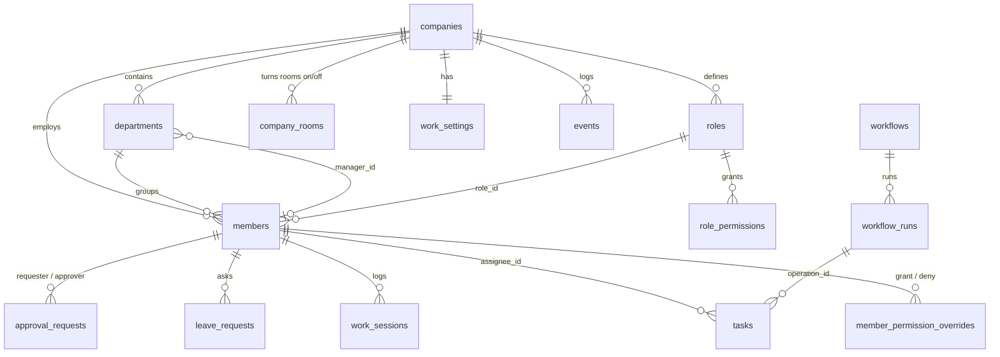

# 11 — ERD and data dictionary (analytics view of the real schema)

This is the **real** schema (`src/db/schema.ts`, migrations up to `0035`), limited to the tables analytics reads, plus the access-control tables. It replaces the logical ERD in `Almaqar.pdf`. See [10-analytics-srs.md](10-analytics-srs.md) for how the PDF's names map to these.

## Diagram

## Data dictionary

| Table | Columns analytics uses | Notes |
|---|---|---|
| companies | id, slug, name | Tenant boundary. Every other table has `company_id`, and RLS checks `private.is_member(company_id)` |
| members | id, company_id, role (`owner`/`admin`/`employee`), role_id, name, department_id | `status` is live presence, not employment status |
| departments | id, company_id, name, color, active, manager_id | The PDF's "team". One manager per department; the manager is a label and gives no access by itself (decision 2026-10-15) |
| roles / role_permissions | role_id, permission, department_ids `uuid[]` | `department_ids` NULL = all departments. This is the PDF's `user_roles.scope` |
| member_permission_overrides | member_id, permission, effect (`grant`/`deny`), department_ids | Per-person exceptions |
| tasks | assignee_id, status (`todo`/`in_progress`/`done`), priority, due_date, created_at, completed_at, operation_id, client_id, task_type, tracked_minutes | `completed_at` is set when status becomes `done` and cleared otherwise |
| work_settings | day_start, day_end, break_minutes, grace_minutes, time_zone | One row per company |
| work_sessions | member_id, started_at, ended_at, source (`timer`/`manual`) | One open session per member |
| leave_requests | member_id, type, starts_on, ends_on, days, status | Only `approved` reduces expected hours |
| approval_requests | requester_id, approver_id, status, due_on, created_at, decided_at | Waiting approvals are counted at the approver's department |
| workflow_runs | code, owner_id, status, current_step, history `[{action, stepIndex, byId, at}]`, created_at | `history` is the only per-step time trail |
| events | type, source, severity, payload, actor_id, created_at | The audit log (`emitEvent`) |

## Gaps

| Gap | Effect | Release-1 workaround | Possible fix later |
|---|---|---|---|
| Tasks have no department | Department figures follow the assignee's **current** department, so moving a person moves their history | Documented on the page ("based on today's departments") | Add `tasks.department_id`, filled on create |
| No "blocked" task status | Cannot count blocked work directly | Use overdue tasks, waiting approvals, stuck workflow steps | Add a `blocked` status with a reason |
| No task status history | No time per status, no cycle time beyond created→done | Median created→done | Write `task.*` events or a status-history table |
| Membership is not time-bounded | No "who was in the department last March" | Current membership only | `department_memberships(valid_from, valid_to)` |
| One manager per department | The PDF's many-to-many managerships | A person can be given `analytics.departments` for several departments | A managerships table if needed |
| No targets table | "On target" needs a target | Fixed defaults in `calc.ts` (for example timeliness ≥ 80%) | `department_targets` set by the owner |
