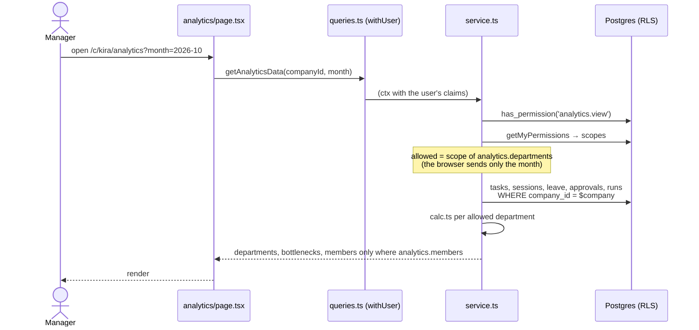

# 13 — Analytics architecture

`Almaqar.pdf` proposes separate services (dataset service, analytics worker, dashboard query service, report generator). Release 1 needs none of these. Analytics is one more feature module, with the same pattern as `hours` and `leave`, and reads live data.

## Components (release 1)

| Part | File | Job |
|---|---|---|
| Page + guard | `src/app/[locale]/(app)/c/[companySlug]/analytics/{layout,page}.tsx` | `RoomGuard room="analytics"`; real company → `getAnalyticsData`, `/c/demo` → `demoAnalyticsData` |
| Query | `src/modules/analytics/queries.ts` | `cache` + `withUser` (per request, per user) |
| Service | `src/modules/analytics/service.ts` | `requireMember`, `analytics.view`; resolves allowed departments from `getMyPermissions`; reads the tables under RLS; calls `calc.ts` |
| Calculations | `src/modules/analytics/calc.ts` | Pure functions, one per KPI (see [10](10-analytics-srs.md#3-metrics-release-1)); unit-tested |
| Demo data | `src/modules/analytics/demo.ts` | Built from `@/modules/hq/mock`, dates relative to today |
| UI | `src/modules/analytics/components/analytics-view.tsx` | Month picker, summary tiles, comparison table, bottlenecks, department details, metric help. Tailwind bars, no chart library |
| Permissions | `catalog.ts`, migration `0036_analytics` | `analytics.view`, `analytics.departments` (scoped), `analytics.members` (scoped) |

## Request flow

## Rules

- **Authorization is checked where the data is read.** The service checks it, and RLS checks it again; the page guard is only UX. Department scope comes from the user's role and overrides, never from the request.
- **No cache across users or requests.** React `cache()` lasts one request. A role change takes effect on the next page load (UC-05).
- **Failure handling:** a missing `work_settings` row falls back to the defaults; a metric with too few items returns `insufficient`; errors use the shared `AppError` codes.
- **Release 2** adds a `analysis_jobs` table, a worker (Supabase cron / queue), and private storage for imports and reports. Each piece gets the same three checks: who, which action, which scope.
